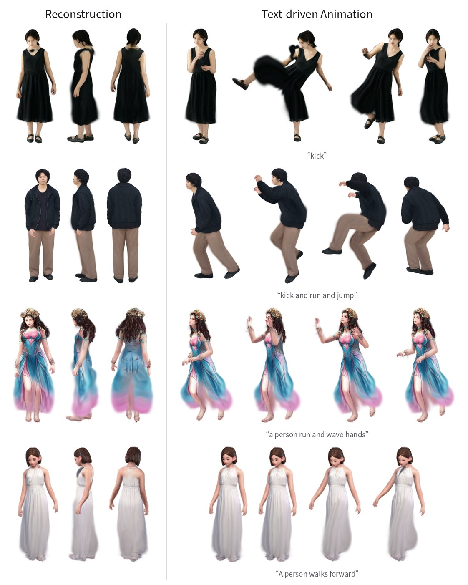
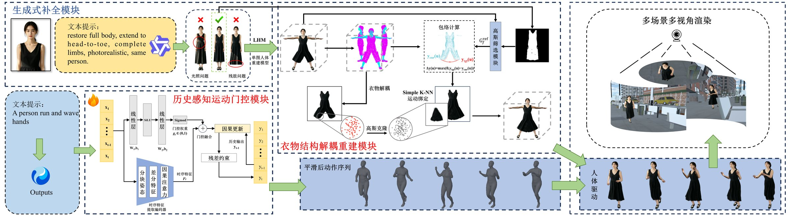

<div align="center">

# 基于结构解耦的三维高斯数字人动画生成

### 3D Gaussian Splatting Digital Human Animation Generation Based on Structural Decoupling

王雪平<sup>1</sup>, 廖偲宇<sup>1</sup>, 黄迪<sup>2,*</sup>, 闫飞虎<sup>1</sup>, 赵光哲<sup>1</sup>

<sup>1</sup>北京建筑大学智能科学与技术学院 &nbsp;&nbsp; <sup>2</sup>北京航空航天大学计算机学院 &nbsp;&nbsp; <sup>*</sup>通信作者

**计算机辅助设计与图形学学报（审稿中）**

<a href="https://zxm0721.github.io/sdgs-avatar/"></a>


<a href="https://zxm0721.github.io/sdgs-avatar/#scenes"></a>



</div>

仅以**单张半身照**和**一段动作文本**为输入，生成可在多种三维场景中驱动的三维高斯数字人动画。左：重建的三维高斯数字人的正面、侧面与背面；右：由 HY-Motion 根据引号中的文本生成、经 PAMG 优化的动作驱动结果。

## 方法



- **生成式补全**：补全半身照缺失的下半身并提取主体，保留原图的人脸与服装外观，供单图三维高斯重建（LHM）使用。
- **衣物结构解耦重建（CDRM）**：通过目标包络估计、高斯克隆与属性迁移补全裙装在双腿之间缺失的衣物，使裙摆在动作中保持连续。
- **历史感知运动门控（PAMG）**：根据历史运动状态门控 HY-Motion 生成的动作序列，抑制局部抖动、时序间断与幅值异常。

更多交互演示（文本切换驱动、CDRM 前后对比、360° 视图、PAMG 同步对比与多场景视频）见 **[项目主页](https://zxm0721.github.io/sdgs-avatar/)**。

## 引用

```bibtex
@article{wang2026sdgs,
  title   = {基于结构解耦的三维高斯数字人动画生成},
  author  = {王雪平 and 廖偲宇 and 黄迪 and 闫飞虎 and 赵光哲},
  journal = {计算机辅助设计与图形学学报},
  year    = {2026},
  note    = {审稿中}
}
```

## 致谢

本工作得到国家自然科学基金（62402026）和北京市教育委员会科研计划项目（KM202410016010）资助。

<details>
<summary>本仓库说明（项目主页源码）</summary>

本仓库是项目主页的静态网页源码（HTML/CSS/JS，无需构建），本地预览：`python3 -m http.server 8000` 后打开 `http://localhost:8000`。

- `static/images/`：论文图（`figNN_*`）与 CDRM 规范空间对比图；`assets/teaser.jpg`：本 README 的示意图。
- `static/videos/hero_*`、`pamg_*`：由导出的三维高斯模型直接渲染的片段（地面网格与接触阴影用同一相机绘制）；`orbit_*_sprite.jpg`：48 视角转台图；`demo_*`：多场景演示视频。
- `static/js/main.js`：同步播放、文本切换、对比滑块与拖动旋转，无第三方依赖。

</details>
